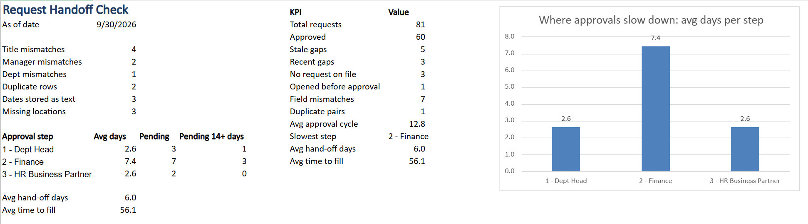
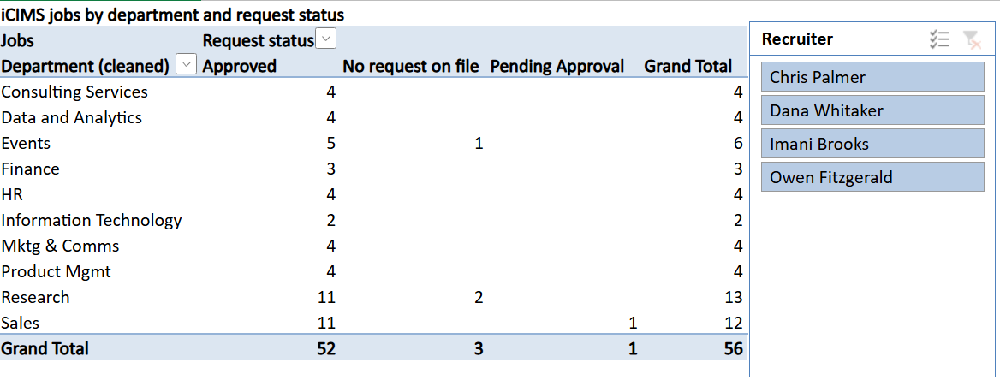

# 📋 Request Handoff Check

> Where hiring requests get stuck between approval and iCIMS. An Excel mini project on synthetic HR operations data.

---

## ❓ The Question

Hiring requests get approved on a request site, then retyped by hand into iCIMS for posting. So where does time get lost, and where does the data stop matching between the two systems?

---

## 🔍 What I Found

- **Finance is the bottleneck:** 7.4 days per approval on average, nearly 3x the other steps (2.6 days each), with 3 approvals stuck 2+ weeks.
- **Handoff delay:** approved requests wait about 6 days before they're opened in iCIMS, time lost to manual re-entry.
- **Time to fill:** 56.1 days on average, from final approval to accepted offer.
- **7 field mismatches** between the systems: 4 job titles, 2 hiring managers and 1 department.
- **3 iCIMS jobs with no request on file,** including one with a typo in its ID (O instead of 0).
- **1 job opened before approval,** and **5 stale gaps:** requests approved over a week ago and still not in iCIMS.
- **Smaller cleanup:** 1 duplicate request pair, 3 dates stored as text and 3 missing locations.

---

## 🖥️ Screenshots

### Dashboard

### Jobs by department, with a recruiter slicer

---

## 📁 Files

| File | What it is |
|---|---|
| `Req_Handoff_Check.xlsx` | The finished analysis, with every check, the dashboard and the pivot |
| `data/Req_Handoff_Raw.xlsx` | The untouched synthetic exports, before any checks were added |
| `screenshots/` | Dashboard and pivot screenshots |

---

## 🗂️ What's Inside

| Sheet | What it does |
|---|---|
| About | Project summary and findings |
| Dashboard | KPIs, approval step breakdown and chart, driven by the as-of date |
| ReqSite_Export | Requests from the approval site, plus checks for iCIMS status, gaps and duplicates |
| Approvals_Log | Every approval step, who handled it and how many days it sat there |
| iCIMS_Export | Jobs from iCIMS, plus columns that clean IDs and match them back to requests |
| Dept_Map | Translates department names between the two systems |
| Pivot | Jobs by department and request status, with a recruiter slicer |

---

## 🛠️ Tricks Used

- XLOOKUP and COUNTIFS to match records across systems, and AVERAGEIFS for step timing
- TRIM and SUBSTITUTE to strip hidden spaces, and DATEVALUE to fix dates stored as text
- UNIQUE, SORT and HSTACK for live lists, plus a PivotTable, a slicer and a chart

---

## ⚠️ Heads Up

- All names and requests are made up. The data is synthetic, built to practice HR operations analysis.
- The raw exports include realistic data issues, like hidden spaces, a typo in an ID and dates stored as text, to practice catching them.
- Needs Excel 365, since it uses XLOOKUP, UNIQUE and HSTACK.
- GitHub can't preview Excel files, so download `Req_Handoff_Check.xlsx` to explore it.

---

## 👤 Author

**Showrish Reddy Sampath** · MPS Applied Machine Intelligence, Northeastern University · [LinkedIn](https://linkedin.com/in/showrish-reddy-sampath-b508a22a6)
